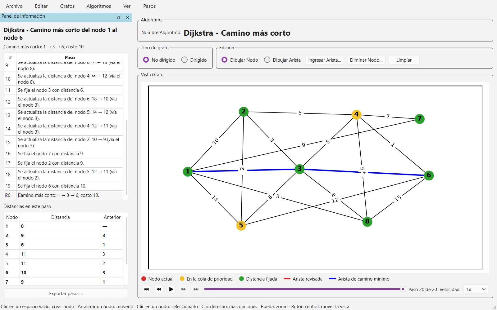
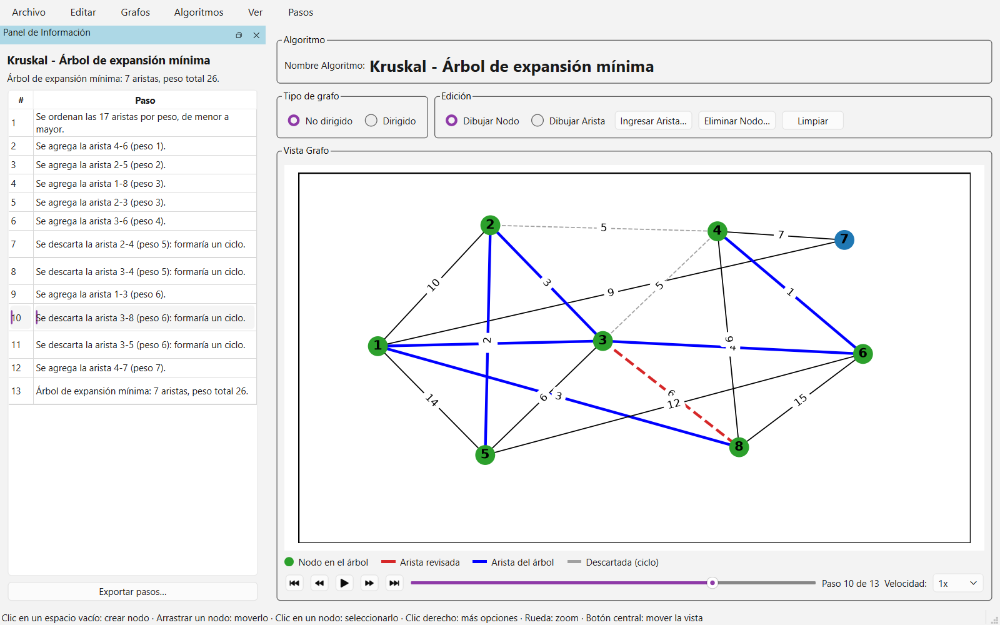
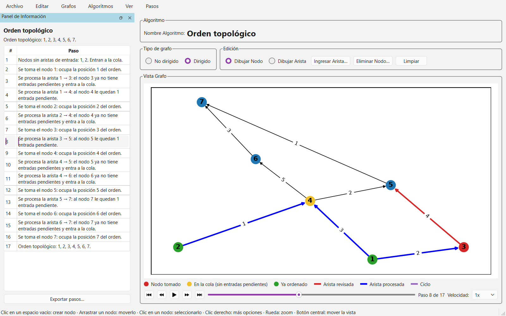
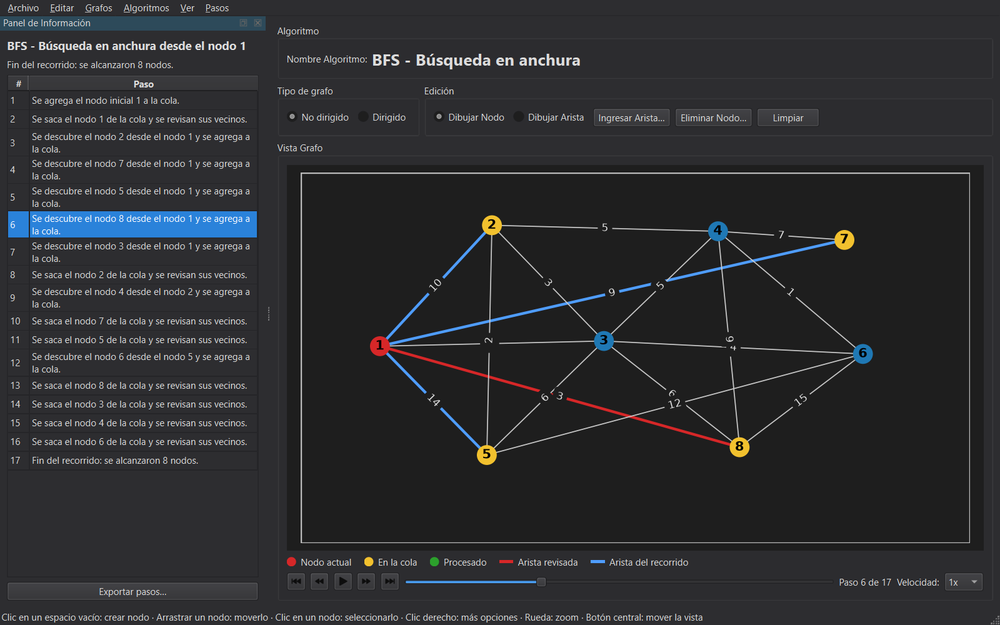

# Visualizador de Grafos y Algoritmos de recorridos

## Graficador de grafos con recorridos, árboles mínimos y caminos más cortos
Este proyecto es una aplicación gráfica desarrollada en Python utilizando las bibliotecas PyQt6 y NetworkX. La aplicación permite dibujar y manipular grafos y ejecutar sobre ellos algoritmos clásicos (BFS, DFS, Kruskal, Prim, Dijkstra, Bellman-Ford, orden topológico y detección de ciclos), que se pueden seguir paso a paso.

> ⭐ **¿Te resulta útil?** Si este proyecto te ayuda a estudiar, enseñar o entender mejor los grafos, me harías muy feliz regalándole una estrella en GitHub (el botón **Star**, arriba a la derecha). No cuesta nada y me motiva a seguir mejorándolo. ¡Gracias!

## Capturas

| Camino más corto con Dijkstra | Kruskal paso a paso |
| --- | --- |
|  |  |
| **Orden topológico de un grafo dirigido** | **Tema oscuro** |
|  |  |

## Características principales
- **Edición directa con el mouse**: crear nodos con un clic, unirlos con aristas haciendo clic en el origen y el destino, arrastrarlos para moverlos y usar el clic derecho para editar pesos o eliminar elementos.
- **Grafos dirigidos y no dirigidos**: se elige el tipo desde la cabecera de la ventana. Los pesos son enteros y pueden ser negativos.
- **Deshacer y rehacer**: todas las ediciones del grafo se pueden deshacer (Ctrl+Z) y rehacer (Ctrl+Y).
- **Resultados que se actualizan solos**: al editar el grafo se vuelve a calcular el último algoritmo ejecutado.
- **Algoritmos paso a paso**: cada algoritmo se puede recorrer paso a paso o reproducir como animación, con colores para el nodo actual, los nodos en espera (cola, pila o cola de prioridad), los ya procesados y las aristas revisadas, elegidas, descartadas o que forman un ciclo. Una leyenda explica cada color.
- **Tabla de pasos**: el panel lateral describe cada paso; al elegir una fila, el grafo muestra ese momento. Los pasos se pueden exportar a CSV o a texto.
- **Grafos aleatorios y listas de adyacencia**: genera grafos al azar con la cantidad de nodos, aristas y rango de pesos que elijas, o importa y exporta el grafo como lista de adyacencia en texto.
- **Zoom y desplazamiento**: la rueda del mouse acerca o aleja la vista y el botón central la desplaza.
- **Tema oscuro**: se activa desde el menú Ver y se recuerda para la próxima vez.

## Algoritmos de grafos
- **BFS (Búsqueda en anchura)** y **DFS (Búsqueda en profundidad)** desde un nodo inicial.
- **Kruskal** y **Prim (Árbol de expansión mínima)**, para grafos no dirigidos. Muestran el peso total y las aristas descartadas por formar un ciclo; Prim crece desde un nodo inicial.
- **Dijkstra (Camino más corto)**, con pesos no negativos. Calcula las distancias a todos los nodos o el camino y el costo hasta un nodo destino, con la tabla de distancias de cada paso.
- **Bellman-Ford (Camino más corto con pesos negativos)**. Igual que Dijkstra, pero admite pesos negativos y detecta los ciclos de peso negativo, que resalta en el grafo.
- **Orden topológico (algoritmo de Kahn)**, para grafos dirigidos. Si el grafo tiene un ciclo, lo muestra y explica por qué no existe el orden.
- **Detección de ciclos**, en grafos dirigidos y no dirigidos.

## Guardado y carga de grafos
Los grafos se guardan y cargan en formato JSON, lo que permite guardar el trabajo y continuar en otra sesión. También se pueden importar y exportar como lista de adyacencia en texto:

```
dirigido              # opcional: "dirigido" o "no dirigido" (por defecto)
1: 2(10), 3(6), 7     # nodo: vecino(peso), ...  (el peso es opcional; por defecto 1)
2: 4(-5)
5:
```

En `datos/ejemplo_tareas.txt` hay un ejemplo con dependencias entre tareas, útil para probar el orden topológico.

## Exportación de imágenes
Los grafos pueden ser exportados como imágenes en formato PNG.

## Requisitos
- **Python 3.9 o superior**
- **PyQt6**
- **NetworkX**
- **Matplotlib**

Instalación de dependencias:

```bash
pip install -r requirements.txt
```

## Estructura del código
El código está separado en tres capas: los algoritmos y el modelo no dependen de la interfaz gráfica, por lo que se pueden probar y reutilizar por separado.

```
Graficador.py            Punto de entrada
iniciar.bat, iniciar.sh  Crean el entorno virtual si hace falta y abren la aplicación
empaquetar.py            Genera el ejecutable con PyInstaller
docs/                    Capturas del README y el script que las genera
algoritmos/              Funciones puras sobre grafos de NetworkX
  pasos.py               Paso: estado del algoritmo después de cada paso
  recorridos.py          bfs, dfs (y sus versiones *_pasos)
  arbol_minimo.py        kruskal, prim
  camino_minimo.py       dijkstra, bellman_ford, camino_minimo
  orden_topologico.py    orden_topologico (Kahn)
  ciclos.py              detectar_ciclo
modelo/                  Estado del grafo, independiente de la interfaz
  grafo.py               ModeloGrafo: nodos, posiciones, colores, guardado y carga
  lista_adyacencia.py    Lectura y escritura de listas de adyacencia
  generacion.py          Grafos aleatorios y ubicación automática de los nodos
ui/                      Interfaz PyQt6
  ventana_principal.py   MainWindow: menús, panel lateral, tema y preferencias
  panel_vista.py         PanelVista: controles de edición y ejecución de algoritmos
  lienzo.py              Lienzo: dibuja el grafo, zoom y traducción del mouse en acciones
  panel_informacion.py   PanelInformacion: resumen, tabla de pasos, distancias y exportación
  reproductor.py         Reproductor: controles para recorrer y animar los pasos
  estilos.py             Colores de cada estado y leyendas de cada algoritmo
  tema.py                Temas claro y oscuro
  leyenda.py             Leyenda de colores bajo el lienzo
  comandos.py            Comandos de deshacer/rehacer (QUndoStack)
  dialogos.py            Diálogos para elegir nodos, ingresar aristas y generar grafos
datos/                   Grafo de prueba (Nodos.txt, Aristas.txt) y ejemplo de lista de adyacencia
tests/                   Pruebas con pytest
```

## Uso
La barra de estado, en la parte inferior de la ventana, muestra en todo momento qué hace cada clic en el modo actual.

- **Dibujar nodos**: con "Dibujar Nodo" activo, haz clic en un espacio vacío del lienzo. Haz clic en un nodo para seleccionarlo (se resalta en naranja) y arrástralo para moverlo.
- **Dibujar aristas**: con "Dibujar Arista" activo, haz clic en el nodo de origen y luego en el de destino, e indica el peso (un entero, que puede ser negativo). Si la arista ya existe, se actualiza su peso. También puedes usar "Ingresar Arista…" para escribir los nodos y el peso.
- **Editar y eliminar**: clic derecho sobre un nodo para eliminarlo o ejecutar un algoritmo desde él; clic derecho sobre una arista para editar su peso o eliminarla.
- **Ejecutar algoritmos**: elige un algoritmo del menú "Algoritmos". BFS, DFS y Prim piden el nodo inicial en una lista desplegable, que sugiere el nodo seleccionado o el último usado; Dijkstra y Bellman-Ford piden además un nodo destino opcional ("Todos los nodos" calcula todas las distancias). Con un nodo seleccionado, el clic derecho sobre otro nodo ofrece el camino más corto entre ambos.
- **Ver paso a paso**: al ejecutar un algoritmo se muestra el resultado final. Con los controles bajo el lienzo puedes ir al primer paso, avanzar o retroceder de a uno, reproducir la animación y elegir su velocidad. También puedes hacer clic en una fila de la tabla de pasos.
- **Exportar pasos**: el botón "Exportar pasos…" del panel lateral (o Archivo → Exportar Pasos…) guarda los pasos en CSV o en texto; en Dijkstra y Bellman-Ford incluye también las distancias finales.
- **Grafo de prueba y grafo aleatorio**: en el menú "Grafos". El grafo de prueba está definido en `datos/Nodos.txt` y `datos/Aristas.txt`.
- **Listas de adyacencia**: en el menú "Grafos", "Importar Lista de Adyacencia…" y "Exportar Lista de Adyacencia…".
- **Recorrido seleccionado**: en el menú "Grafos", conserva solo las aristas del último recorrido calculado.
- **Zoom**: rueda del mouse sobre el lienzo, o el menú "Ver". Arrastra con el botón central para mover la vista.
- **Guardar y cargar grafos**: opciones del menú "Archivo", en formato JSON.
- **Exportar imagen**: "Guardar Imagen" exporta el grafo como PNG.

### Atajos de teclado

| Acción | Atajo |
| --- | --- |
| Guardar avance / Cargar avance | Ctrl+S / Ctrl+O |
| Guardar imagen / Exportar pasos | Ctrl+E / Ctrl+Shift+E |
| Deshacer / Rehacer | Ctrl+Z / Ctrl+Y |
| Modo nodo / Modo arista | N / A |
| Cancelar la selección | Esc |
| Eliminar el nodo seleccionado | Supr |
| Limpiar el grafo | Ctrl+L |
| Grafo de prueba / Grafo aleatorio | Ctrl+T / Ctrl+G |
| Importar / Exportar lista de adyacencia | Ctrl+I / Ctrl+Shift+I |
| Recorrido seleccionado | Ctrl+R |
| BFS / DFS / Kruskal / Dijkstra | Ctrl+1 / Ctrl+2 / Ctrl+3 / Ctrl+4 |
| Prim / Bellman-Ford / Orden topológico / Detección de ciclos | Ctrl+5 / Ctrl+6 / Ctrl+7 / Ctrl+8 |
| Reproducir o pausar la animación | Ctrl+P |
| Paso anterior / Paso siguiente | Ctrl+← / Ctrl+→ |
| Primer paso / Último paso | Ctrl+Inicio / Ctrl+Fin |
| Acercar / Alejar / Restablecer vista | Ctrl++ / Ctrl+- / Ctrl+0 |
| Tema oscuro | Ctrl+Shift+D |

## Ejecución
La forma más simple es usar el script de inicio. La primera vez crea un entorno virtual (`.venv`) dentro del proyecto e instala las dependencias; las siguientes veces abre la aplicación directamente.

- **Windows**: doble clic en `iniciar.bat`.
- **Linux o macOS**: `sh iniciar.sh` desde una terminal.

Si prefieres manejar tú las dependencias, después de instalarlas ejecuta el archivo principal:

```bash
python Graficador.py
```

## Ejecutable sin Python
Para generar una versión que se pueda abrir sin instalar Python:

```bash
pip install -r requirements-dev.txt
python empaquetar.py
```

El resultado queda en `dist/GraficadorGrafos/`. Esa carpeta completa se puede copiar a otra computadora con el mismo sistema operativo y abrir `GraficadorGrafos` directamente.

## Pruebas
Los algoritmos se comparan contra las implementaciones de NetworkX; también hay pruebas del modelo y pruebas de humo de la interfaz (se ejecutan sin abrir ventanas).

```bash
pip install -r requirements-dev.txt
pytest
```

Las capturas de este README se generan con la aplicación real; el script muestra cada pantalla unos segundos antes de guardarla en `docs/capturas/`:

```bash
python docs/generar_capturas.py
```

## Contribuciones
Si deseas contribuir a este proyecto, siéntete libre de hacer un fork y enviar un pull request. Cualquier mejora, corrección de errores o nueva funcionalidad es bienvenida.

Y si el proyecto te sirvió, una ⭐ en GitHub es la mejor forma de decir gracias y ayuda a que más estudiantes lo encuentren.

## Licencia
Este proyecto está bajo la licencia MIT. Consulta el archivo `LICENSE` para más detalles.
